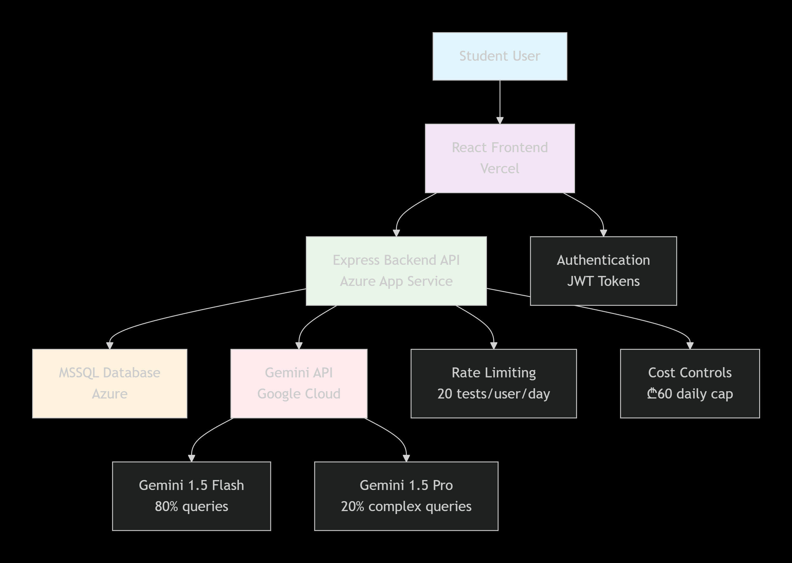

# Project Overview: Dialogos — AI-Driven Entrance Exam Tutor

## 1. Project Goal & Core Problem

**Dialogos** is an AI-powered adaptive tutoring platform that helps Georgian high school students prepare for National Entrance Exams by providing personalized practice tests with Socratic feedback, solving the critical problem of expensive private tutoring and static, non-adaptive study resources.

## 2. MVP Scope & Key Features

### Features IN Scope for MVP:
- User authentication (signup/login with JWT)
- Adaptive test generation for Math and Logic subjects
- Dynamic difficulty calibration (1-5 scale)
- Multiple-choice question interface
- Answer grading and scoring
- Socratic feedback for incorrect answers
- Basic performance tracking
- Rate limiting and API cost controls

### Features OUT of Scope for MVP:
- English subject support
- Advanced performance dashboard analytics
- Mobile app development
- LMS integration
- Multiplayer features
- OAuth social login

## 3. Target Audience

**Primary Users:** Georgian high school students (ages 17-18) preparing for National Entrance Exams, particularly from middle-income families who cannot afford private tutoring (₾50-80/hour).

**Secondary Users:** Exam preparation teachers and tutors who need to assign adaptive homework and monitor student progress.

## 4. Technology Stack

| Category | Technology | Specific Version | Notes |
|----------|------------|------------------|-------|
| Frontend Framework | React | 18.2.0 | Component-based UI library |
| Build Tool | Vite | 4.4.0 | Faster development build |
| Frontend Deployment | Vercel | Latest | Free tier, auto-deploy from GitHub |
| Backend Runtime | Node.js | 20.9.0 LTS | JavaScript runtime |
| Backend Framework | Express | 4.18.2 | Web framework for Node.js |
| Backend Deployment | Azure App Service | - | Free student tier |
| Database | MSSQL | Latest | Azure-hosted, relational model |
| ORM | Sequelize | 6.33.0 | SQL query builder and migrations |
| AI Service | Google Gemini API | 1.5 | gemini-1.5-flash (80%) + gemini-1.5-pro (20%) |
| Authentication | JWT | 9.0.2 | JSON Web Tokens for auth |
| Styling | Tailwind CSS | 3.3.0 | Utility-first CSS framework |
| HTTP Client | Axios | 1.5.0 | API communication |
| Charts | Chart.js | 4.4.0 | Performance visualizations |
| Logging | Winston | 3.10.0 | Structured logging |
| Testing | Jest | 29.6.0 | Unit testing framework |
| Version Control | Git | - | GitHub repository |

## 5. High-Level Architecture

**Architecture Style:** Monolithic backend with React frontend, following REST API principles with JWT authentication.

## 6. Core Components/Modules

**React Frontend:** User interface for test configuration, question display, feedback review, and performance tracking

**Express Backend:** API server, business logic orchestration, AI integration, and data persistence

**MSSQL Database:** Store user accounts, test history, student responses, and performance analytics

**Gemini AI Service:** Dynamic question generation, Socratic feedback, and difficulty calibration

**Authentication Service:** JWT-based user authentication and authorization

## 7. Key UI/UX Considerations

- **Adaptive Learning Focus:** Interface should clearly show difficulty progression and personalized recommendations
- **Student-Centric Design:** Simple, intuitive navigation suitable for 17-18 year old students
- **Progress Visibility:** Clear performance tracking and improvement metrics
- **Responsive Design:** Accessible on both desktop and mobile web browsers
- **Minimal Cognitive Load:** Clean interface that doesn't distract from learning

## 8. Coding Standards & Quality Criteria

**Style Guide:** Airbnb JavaScript Style Guide  
**Formatter:** Prettier with .prettierrc configuration  
**Linter:** ESLint with .eslintrc.js  
**Key Patterns:** Repository Pattern for data access, DRY principle  
**File Naming:** kebab-case for components, PascalCase for React components  

**Top 3 Quality Criteria Focus:**
1. **Reliability:** 100% mathematical correctness in generated questions
2. **Performance:** <3s response time for test generation
3. **Cost-efficiency:** <₾0.30 per test generation

## 9. Testing Strategy

**Required Test Types:** Unit Tests, Integration Tests, E2E Tests  
**Testing Framework:** Jest 29.6.0 for backend, React Testing Library for frontend  
**Minimum Code Coverage:** 80%  
**Testing Conventions:** AAA pattern for unit tests, test files adjacent to source  
**Verification Approach:** CI/CD pipeline with automated tests before deployment

## 10. Initial Setup Steps

1. `https://github.com/Nok1on1/cs-ai-2025-team-psychonauts-5`
2. `cs-ai-2025-team-psychonauts-5`
3. `cp backend/.env.example backend/.env`
4. Manually edit backend/.env with required API keys and database credentials
5. `python -m venv venv`
6. `source venv/bin/activate`
7. `pip install -r requirements.txt`
8. `npm install` in both frontend and backend directories
9. `npm run db:migrate` to set up database schema
10. `npm run dev` to start development servers or `python app.py`

## 11. Key Architectural Decisions

**Database Choice (MSSQL):** Selected for team familiarity, free Azure student tier, and relational structure fitting our user→tests→responses data hierarchy

**AI Model Strategy (Gemini Flash + Pro):** Cost-optimized hybrid approach using cheaper Flash model for 80% of queries and Pro only for complex multi-step reasoning

**Frontend Deployment (Vercel):** Chosen over Azure Static Web Apps for superior developer experience, faster deployments, and better modern tooling integration

## 12. Project Documentation

- **Project Overview:** `./docs/project-overview.md`
- **API Documentation:** `./docs/api-endpoints.md`
- **Development Guide:** `./docs/development-setup.md`
- **Deployment Guide:** `./docs/deployment.md`
- **User Testing Plan:** `./docs/user-testing-plan.md`

## 13. Repository Link

**Main Repository:** `https://github.com/Nok1on1/cs-ai-2025-team-psychonauts-5`

## 14. Dependencies & Third-Party Services

**Google Gemini API:** AI question generation and feedback (requires API key)  
**Azure App Service:** Backend hosting (free student tier)  
**Azure MSSQL:** Database hosting (free student tier)  
**Vercel:** Frontend hosting (free tier)  

**Required API Keys/Credentials:**
- Gemini API key (from Google AI Studio)
- Azure database connection string
- JWT secret key

**Rate Limits/Quotas:** Max 20 test generations per user per day, ₾60 daily API cost cap

## 15. Security Considerations

**Authentication Method:** JWT tokens with 7-day expiration  
**Authorization Approach:** Role-based access control (student/teacher)  
**Data Protection:** HTTPS/TLS encryption, password hashing with bcrypt  
**Key Security Risks:** SQL injection (mitigated with Sequelize ORM), XSS (React auto-escapes), prompt injection (input sanitization)  
**Compliance Requirements:** Student data minimization, 6-month data retention policy

## 16. Performance Requirements

**Load Capacity:** Support 100 concurrent users, 1000 requests/day  
**Response Time:** API endpoints <500ms P95, test generation <3s P95  
**Scalability Approach:** Horizontal scaling ready on Azure, Redis caching for performance summaries  
**Resource Constraints:** Stay within free Azure student tier, <₾150 total project budget

## 17. Monitoring & Observability

**Logging Strategy:** Structured logging with Winston (error, warn, info levels)  
**Monitoring Tools:** Azure Application Insights for error tracking, custom cost dashboard  
**Key Metrics:** Error rates, API latency, LLM token usage, user satisfaction scores  
**Alerting Criteria:** Email alert when error rate >5% or API latency >2s

## 18. Deployment & DevOps

**Deployment Strategy:** GitHub Actions auto-deploy to Vercel (frontend) and Azure (backend) on push to main  
**Environment Strategy:** Dev (local), Staging (Vercel preview), Production (Vercel + Azure)  
**CI/CD Pipeline:** GitHub Actions running tests on PR, auto-deploy on merge to main  
**Infrastructure as Code:** N/A for student project  
**Backup & Disaster Recovery:** Daily database backups via Azure, code in GitHub