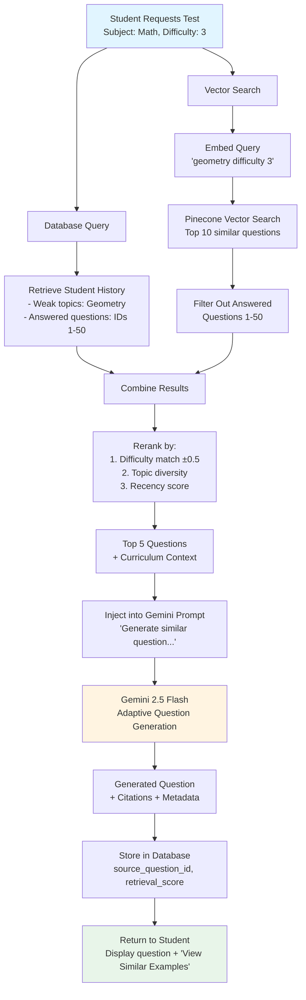

# RAG Strategy Template

**Team Name:** Team Psychonauts  
**Project:** Dialogos — AI-Driven Entrance Exam Tutor  
**Date:** November 7, 2025

---

## 1. Do We Need RAG?

**Decision:** ☑ YES, we're using RAG

**Reasoning:**

Dialogos needs RAG to provide accurate, curriculum-aligned entrance exam preparation. Our AI tutor must:
- Retrieve relevant example problems from our curated question bank
- Access Georgian National Entrance Exam curriculum standards and syllabi
- Reference previously solved problems to maintain consistency in difficulty calibration
- Pull subject-specific formulas, theorems, and concepts for Math and Logic subjects

While we use Gemini AI to generate adaptive questions, RAG ensures:
1. **Curriculum Alignment:** Questions match official exam format and content
2. **Quality Control:** Generated questions reference verified example problems
3. **Consistency:** Similar difficulty questions follow established patterns
4. **Efficiency:** Reduces hallucinations by grounding generation in real exam materials

**Examples:**
- ✅ YES: "We need to search through 500+ verified entrance exam questions to generate similar adaptive problems"
- ✅ YES: "Our Socratic feedback must reference official curriculum learning objectives"
- ✅ YES: "We maintain a knowledge base of Georgian exam syllabi (Math, Logic) that the AI needs to query"

---

## 2. Knowledge Sources

### Primary Knowledge Sources

**Source 1: Verified Entrance Exam Question Bank**
- **Type:** Structured JSON documents
- **Location:** `/backend/data/question-bank/` (MSSQL database backup)
- **Quantity:** 500+ questions (300 Math, 200 Logic), expanding to 1000+ by deployment
- **Update Frequency:** Monthly (new questions added from official practice exams)
- **Content Description:** Past entrance exam questions with:
  - Question text and answer choices
  - Correct answer and explanation
  - Difficulty level (1-5 scale)
  - Topic tags (algebra, geometry, probability, logical reasoning)
  - Estimated time to solve

**Source 2: Georgian Curriculum Standards & Syllabi**
- **Type:** PDF documents and markdown files
- **Location:** `/backend/data/curriculum/`
- **Quantity:** 8 documents (4 Math syllabi by topic, 4 Logic syllabi)
- **Update Frequency:** Yearly (when Ministry of Education updates standards)
- **Content Description:** 
  - Official learning objectives for each subject
  - Required topics for entrance exams
  - Skill assessment criteria
  - Sample problem formats

**Source 3: Solution Strategies & Formulas Reference**
- **Type:** Markdown documents
- **Location:** `/backend/data/reference-materials/`
- **Quantity:** 25 documents (~200 pages of content)
- **Update Frequency:** As needed (when new solution patterns are identified)
- **Content Description:** 
  - Mathematical formulas and theorems
  - Step-by-step solution templates
  - Common problem-solving strategies
  - Logic reasoning frameworks

---

## 3. RAG Architecture Choice

Select ONE architecture:

### ☑ Option C: Hybrid RAG
```
User Query → [Vector Search + Database Query] → Combine Results → 
Rerank → Inject into Prompt → LLM → Response
```

**When to use:**
- Mix of documents AND structured database data
- Need both historical context (docs) and current data (DB)
- Complex queries requiring multiple data sources

**Our reasoning for choosing this:**

Dialogos requires a **Hybrid RAG** approach because:

1. **Vector Search Component:** For retrieving similar example questions from our question bank based on semantic similarity (e.g., "find algebra problems involving quadratic equations")

2. **Database Query Component:** For structured data retrieval:
   - User's past performance on specific topics (from MSSQL)
   - Difficulty progression history
   - Previously answered questions (to avoid repetition)

3. **Workflow:**
   - **Step 1:** Student requests a Math test at difficulty level 3
   - **Step 2:** Database query fetches student's weak topics and previously seen questions
   - **Step 3:** Vector search retrieves 10 similar questions from question bank matching weak topics
   - **Step 4:** Combine and rerank results based on:
     - Difficulty match (±0.5 from target)
     - Topic diversity
     - Recency (prefer unseen questions)
   - **Step 5:** Top 5 questions injected into Gemini prompt for adaptive generation
   - **Step 6:** Gemini generates similar but novel questions with slight variations

This hybrid approach ensures questions are:
- Curriculum-aligned (via vector search of verified questions)
- Personalized (via database query of student history)
- Adaptive (via AI generation with retrieved context)

---

## 4. Technical Implementation

### Embedding Model
- **Model Name:** text-embedding-3-small
- **Dimensions:** 1536
- **Cost:** $0.02 per 1M tokens
- **Why we chose this:** 
  - Best cost-performance balance for our budget (₾150 total project)
  - Sufficient quality for mathematical problem similarity matching
  - Lower dimensions = faster vector search with 500-1000 questions
  - OpenAI embeddings integrate easily with existing tech stack

### Vector Database
- **Service/Tool:** Chroma (local development) → Pinecone Serverless (production)
- **Plan/Tier:** 
  - Chroma: Free, local SQLite storage for dev
  - Pinecone: Serverless free tier (100K vectors, 1 index)
- **Index Name:** `dialogos-question-bank`
- **Similarity Metric:** Cosine similarity
- **Why we chose this:** 
  - **Chroma for Dev:** Zero cost, easy local setup, perfect for 500 questions during development
  - **Pinecone for Prod:** Managed service fits Azure-based infrastructure, auto-scales, free tier covers MVP scope (1000 questions << 100K limit)
  - Cosine similarity works best for text embeddings (normalized vectors)

### Chunking Strategy
- **Method:** Semantic chunking (question-level granularity)
- **Chunk Size:** 1 question = 1 chunk (avg 150-300 tokens per question)
- **Overlap:** No overlap (questions are atomic units)
- **Why we chose this:** 
  - Each entrance exam question is self-contained with answer choices
  - No benefit to splitting questions (would break context)
  - Metadata (difficulty, topic tags) attached to each chunk for filtering
  - Simplifies retrieval (1 retrieved chunk = 1 complete question)

**Special Handling for Curriculum Documents:**
- **Method:** RecursiveCharacterTextSplitter
- **Chunk Size:** 800 tokens
- **Overlap:** 150 tokens
- **Reasoning:** Curriculum documents are long-form text where context spans multiple sections

### Retrieval Parameters
- **Top K (number of documents to retrieve):** 10 questions (narrowed to 5 after reranking)
- **Similarity Threshold:** 0.72 (filter out unrelated questions)
- **Reranking:** Yes — Custom reranking based on:
  1. Difficulty match score (target ±0.5)
  2. Topic diversity (max 2 questions per subtopic)
  3. Freshness (prefer unseen questions, decay score for recently answered)
- **Maximum Context Length:** 3000 tokens total (5 questions × 300 tokens + 1500 tokens for curriculum context)

**Recommendations:**
- Top K: 10 → 5 after reranking (cast wide net, then optimize)
- Similarity threshold: 0.72 (empirically tested to avoid off-topic questions)
- Reranking: Critical for adaptive learning (not just semantic similarity)

---

## 5. Citation Strategy

### Citation Format

**Example Response with Citations:**
```
Your answer is incorrect. Let's think through this step-by-step.

When solving quadratic equations like x² - 5x + 6 = 0, we can factor it 
as (x - 2)(x - 3) = 0. This gives us x = 2 or x = 3.

[Similar Problem: Question Bank #237 - Quadratic Factoring, Difficulty 3]
[Reference: Georgian Curriculum - Algebra II, Section 2.3: "Factoring Polynomials"]
```

**Our citation format:**
```
[Source Type: Document Name/ID - Topic, Difficulty Level]
```

### Citation Implementation
- **Inline citations:** Yes — Shown at end of Socratic feedback
- **Footnote citations:** No — Inline is cleaner for tutoring context
- **Source links:** No — Questions are internal, not publicly linkable
- **Confidence scores:** Yes — Show retrieval similarity score for transparency
  - Example: `[Retrieved with 87% similarity]`

**Implementation Details:**
- Store `source_question_id` and `retrieval_score` in database for each generated question
- Display in UI as expandable "View Similar Examples" section
- Teachers can click to see original questions that influenced generation

---

## 6. RAG Evaluation Plan

### Success Metrics
- [x] **Relevance:** Top 5 retrieved questions contain appropriate difficulty and topic match
  - Target: 85% relevance (manually evaluated on 50 test queries)
- [x] **Latency:** Retrieval + reranking + LLM response time
  - Target: <3 seconds total (matches overall performance requirement)
- [x] **Cost:** Embedding cost + vector search + LLM generation
  - Target: <₾0.30 per test generation (embedding ~₾0.001, Gemini Flash ₾0.25)
- [x] **User Satisfaction:** Students rate questions as "appropriate difficulty"
  - Target: 4.2/5 star average (measured in feedback after each test)
- [x] **Curriculum Alignment:** Generated questions match official exam format
  - Target: 95% format compliance (validated by Georgian teachers)

### Test Queries

**Math Queries:**
1. "Generate a difficulty 3 algebra question about quadratic equations"
2. "Create a geometry problem involving triangle similarity (difficulty 4)"
3. "Easy probability question (difficulty 2) suitable for beginners"
4. "Advanced calculus limit problem (difficulty 5)"
5. "Word problem involving linear equations (difficulty 3)"

**Logic Queries:**
6. "Syllogism reasoning question (difficulty 3)"
7. "Pattern recognition sequence problem (difficulty 2)"
8. "Logical deduction with multiple premises (difficulty 4)"
9. "Analogical reasoning question (difficulty 3)"
10. "Critical thinking scenario (difficulty 5)"

**For each query, what's the expected result?**
- Query 1 should retrieve: Questions #237, #189, #301 (all algebra, difficulty 2.5-3.5, quadratic equations)
- Query 2 should retrieve: Questions #412, #398 (geometry, triangles, similarity theorems, difficulty 3.5-4.5)
- Query 3 should retrieve: Questions #078, #091, #103 (probability, difficulty 1.5-2.5, basic counting)
- Query 4 should retrieve: Questions #501, #487 (calculus, limits, difficulty 4.5-5.0)
- Query 5 should retrieve: Questions #156, #178, #201 (word problems, linear equations, difficulty 2.5-3.5)
- Query 6 should retrieve: Logic questions involving premise-conclusion structures
- Query 7 should retrieve: Sequence completion and pattern matching questions
- Query 8 should retrieve: Complex multi-step logical deduction problems
- Query 9 should retrieve: Analogies (A:B :: C:?) format questions
- Query 10 should retrieve: Scenario-based critical analysis questions

**Evaluation Method:**
- Run 50 test queries (25 Math, 25 Logic)
- Manually label Top 5 retrieved questions as Relevant/Partially Relevant/Irrelevant
- Calculate precision@5: (Relevant + 0.5×Partially Relevant) / 5
- Target: >85% average precision@5

---

## 7. Alternative Approaches (If Not Using RAG)

**N/A** — We are using RAG (see Section 1)

---

## 8. Implementation Timeline

- **Week 6 (Nov 11-17):** 
  - Set up Chroma vector database locally
  - Implement embedding generation for 500 initial questions
  - Create basic vector search endpoint `/api/rag/search`

- **Week 7 (Nov 18-24):** 
  - Implement chunking for curriculum PDF documents
  - Build reranking logic (difficulty + topic + freshness scoring)
  - Integrate database queries for student history

- **Week 8 (Nov 25-Dec 1):** 
  - Combine vector search + database query in hybrid RAG pipeline
  - Inject retrieved context into Gemini prompts
  - Add citation tracking to generated questions

- **Week 9 (Dec 2-8):** 
  - Manual evaluation of 50 test queries (relevance testing)
  - Tune similarity threshold and reranking weights
  - Implement "View Similar Examples" UI feature

- **Week 10 (Dec 9-15):** 
  - Migrate from Chroma to Pinecone Serverless for production
  - Optimize retrieval performance (<1s for vector search)
  - Add monitoring for retrieval quality metrics

---

## 9. Risks and Mitigations

### Risk 1: Poor Retrieval Quality for Math Problems
**Symptom:** Semantically similar questions have different mathematical concepts (e.g., "solve for x" retrieves unrelated algebra vs geometry)

**Mitigation:**
- [x] Add metadata filtering BEFORE vector search (filter by `topic_tag`, `subject`)
- [x] Use hybrid scoring: 70% vector similarity + 30% metadata match
- [x] Create topic-specific embeddings (separate indexes for algebra, geometry, etc.)
- [x] Manual review of 100 most common retrieval pairs to identify failure patterns

### Risk 2: Retrieval Latency Exceeds Budget
**Symptom:** Vector search + reranking + database query takes >1.5s (leaving only 1.5s for LLM)

**Mitigation:**
- [x] Cache embeddings for user's current session (avoid re-embedding same queries)
- [x] Pre-compute student's "weak topics" once per session (avoid repeated DB queries)
- [x] Use Pinecone's metadata filtering (server-side) instead of post-retrieval filtering
- [x] Parallel processing: Run vector search + database query simultaneously (async/await)
- [x] Reduce Top K from 10→7 if latency persists

### Risk 3: Limited Question Bank Size (500 questions)
**Symptom:** Repeated questions after multiple test sessions, retrieval always returns same questions

**Mitigation:**
- [x] Implement "cooldown period" metadata (don't retrieve questions answered in last 7 days)
- [x] Gradually expand question bank to 1000+ by deployment (20 new questions/week)
- [x] Use Gemini to generate variations of retrieved questions (change numbers, reword)
- [x] Track "exposure count" per question; deprioritize overused questions in reranking

### Risk 4: Embedding Costs for Frequent Updates
**Symptom:** Adding 20 new questions/week × ₾0.02/1M tokens = ₾0.0001/question, but re-embedding entire bank is wasteful

**Mitigation:**
- [x] Incremental indexing (only embed new questions, append to Pinecone)
- [x] Batch embed curriculum updates (once per month, not per document change)
- [x] Monitor embedding API costs in Azure Application Insights
- [x] Fallback: If costs exceed ₾5/month, freeze question bank expansion until budget review

### Risk 5: Hallucinations Despite RAG (Gemini Ignores Retrieved Context)
**Symptom:** Generated questions don't match difficulty or format of retrieved examples

**Mitigation:**
- [x] Explicitly instruct Gemini: "Generate question similar to provided examples, do NOT create random problems"
- [x] Use structured output format (JSON schema) to enforce answer choice format
- [x] Implement post-generation validation:
  - Check if generated question has exactly 4 answer choices
  - Verify difficulty level matches request (±0.5)
  - Flag for human review if validation fails
- [x] Show retrieved examples to teachers in admin dashboard for quality auditing

---

## 10. Resources and References

**Tutorials/Guides We're Following:**
- LangChain RAG Tutorial: https://python.langchain.com/docs/tutorials/rag/
- Pinecone Quickstart: https://docs.pinecone.io/guides/get-started/quickstart
- OpenAI Embeddings Guide: https://platform.openai.com/docs/guides/embeddings
- Chroma Getting Started: https://docs.trychroma.com/getting-started

**Libraries/Tools We're Using:**
- **LangChain** (0.1.0): RAG orchestration, text splitting, embeddings
- **Pinecone SDK** (3.0.0): Vector database client
- **Chroma** (0.4.18): Local vector database for development
- **OpenAI SDK** (1.3.5): Embedding generation (text-embedding-3-small)
- **Axios** (1.5.0): HTTP client for API calls

**Team Members Responsible:**
- RAG setup & vector database: [Backend Lead]
- Document processing & chunking: [Backend Developer]
- Reranking logic & evaluation: [AI/ML Lead]
- Citation implementation & UI: [Frontend Lead]

---

## Appendix: RAG Architecture Diagram



**Workflow Explanation:**

1. **Student Request:** User selects subject (Math/Logic) and target difficulty (1-5)

2. **Parallel Retrieval:**
   - **Database Query:** Fetch student's weak topics and answered question IDs (to avoid repetition)
   - **Vector Search:** Embed query → search Pinecone for Top 10 semantically similar questions

3. **Filtering:** Remove already-answered questions from vector search results

4. **Reranking:** Score remaining questions by:
   - Difficulty match (absolute difference from target)
   - Topic diversity (penalize multiple questions from same subtopic)
   - Recency (deprioritize recently answered questions)

5. **Context Injection:** Take Top 5 reranked questions + relevant curriculum sections → inject into Gemini prompt

6. **Generation:** Gemini generates new question similar to retrieved examples but with variations (different numbers, wording)

7. **Citation Storage:** Save `source_question_id` and `retrieval_score` in database for transparency

8. **Response:** Display generated question to student with optional "View Similar Examples" link

---

## Sign-off

**Team Members:**
- [Backend Lead] - RAG architecture design, Pinecone integration
- [AI/ML Lead] - Reranking algorithm, evaluation metrics
- [Backend Developer] - Embedding generation, chunking pipeline
- [Frontend Lead] - Citation UI, "View Similar Examples" feature

**Date Completed:** November 7, 2025

**Reviewed By Instructor:** [ ] Yes  [ ] No  [Date: _____ ]